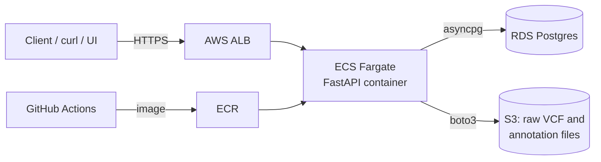

# Architecture: Genomic Variant Analysis Platform

Living document: fill in the empty sections as you build, and update it in the same pull request as
the change it describes. Status markers: **[done]** implemented, **[planned]** designed but not
built yet.

## 1. Overview

A REST API for genomic variant analysis. Users create projects, upload VCF files, the service parses
variants into Postgres, applies annotation files, and returns filtered variants and summaries.

Target deployment (built over the coming weeks):

| Component | Role | Status |
|---|---|---|
| FastAPI app in Docker | REST API | week 1 |
| Postgres (local Docker) | Relational storage | week 1 |
| GitHub Actions: lint, format, tests | Quality gate on every push and PR | week 1 |
| AWS S3 | Raw uploaded files | **[planned]** |
| AWS RDS Postgres | Managed production database | **[planned]** |
| ECR + ECS Fargate + ALB | Image registry, serverless containers, load balancer | **[planned]** |
| GitHub Actions: build, push, deploy | Continuous delivery | **[planned]** |

## 2. Tech stack

| Concern | Tool |
|---|---|
| Language | Python 3.15 (latest stable), same version locally, in Docker and in CI |
| Web framework | FastAPI |
| Validation | Pydantic v2, pydantic-settings for configuration |
| ORM | SQLAlchemy 2.0 async + asyncpg |
| Migrations | Alembic |
| Server | Uvicorn |
| Dependencies | Poetry (`pyproject.toml`, `poetry.lock`) |
| Tests | pytest, pytest-asyncio, pytest-cov, httpx |
| Quality | ruff (lint + format), mypy, pre-commit |
| Containers | Docker, Docker Compose |
| CI | GitHub Actions |

## 3. Layers

> **To do:** describe your layers (at least route handlers, services, models, schemas, database
> session), what each one is responsible for, and what it must not do. Add a diagram if it helps.
> Name the design patterns you use and where.

## 4. Directory layout

> **To do:** your project tree, one line of explanation per folder.

## 5. Request lifecycle

> **To do:** a sequence diagram (Mermaid `sequenceDiagram`) for `POST /projects/`: what happens
> from the incoming request to the response, including validation errors and the database
> transaction.

## 6. Data model

> **To do:** an ER diagram (Mermaid `erDiagram`) for `projects`, `vcf_files`, `variants`,
> `annotation_files` and `annotations`: primary keys, foreign keys, relationships and the main
> columns with types. Week 1 implements `projects` only; the other tables are design.
> Below the diagram, list your key design decisions (keys, constraints, indexes, where file
> contents live, what happens when a project is deleted).

Naming conventions (apply to every table):
- snake_case, plural table names (`projects`, `vcf_files`).
- Primary key `<entity>_id` (`project_id`); a foreign key has the same name as the key it
  references (`vcf_files.project_id`).
- No table prefix on other columns (`projects.name`, not `project_name`).
- Timestamps end in `_at` and are timezone-aware (`created_at`).
- Booleans start with `is_` or `has_`.
- No SQL keywords or abbreviations as names (`description`, not `desc`).

## 7. REST API

| Method | Path | Success | Errors | Status |
|---|---|---|---|---|
| POST | `/projects/` | 201 | | week 1 |
| GET | `/projects/` | 200 | | week 1 |
| DELETE | `/projects/{project_id}/` | 204 | | week 1 |

> **To do:** fill in the error status codes for each endpoint.

Conventions: plural nouns, trailing slash on every path, 201 for create, 204 for delete, 404 for
unknown ids, 409 for conflicts, 422 for invalid input.

## 8. Cross-cutting concerns

### Configuration
All configuration comes from environment variables (a git-ignored `.env` locally; commit only
`.env.example`). Never hard-code credentials.

> **To do:** table of your variables: name, required, default, notes.

### Logging
- One logger per module, output to stdout.
- Levels: DEBUG for storage detail, INFO for successful state changes, WARNING for rejected requests
  (4xx), ERROR for server faults (5xx).
- Never log request bodies, query strings, database URLs, credentials or VCF content.

### Migrations
- Every schema change is an Alembic revision, reviewed by hand before commit.
- Each revision must downgrade cleanly.

### Testing
- Line coverage at least 80% over the whole suite.
- Fast unit tests on in-memory storage, plus integration tests against a real Postgres in Docker.
  Do not mock the database session.
- FIRST principles; Arrange, Act, Assert; one behaviour per test. Every endpoint has a happy-path
  test plus one test per documented error status.

### CI
> **To do:** your pipeline stages and what each one checks.

## 9. Decision log

| # | Decision | Reason |
|---|---|---|
| 1 | Poetry for dependencies | Course requirement; lock file for reproducible installs |

> **To do:** add one row for each non-obvious choice you make.

## 10. Changelog by week

### Week 1
> **To do:** what you built this week.
