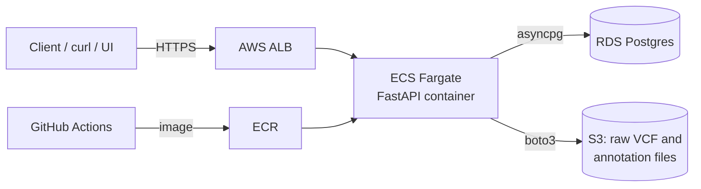
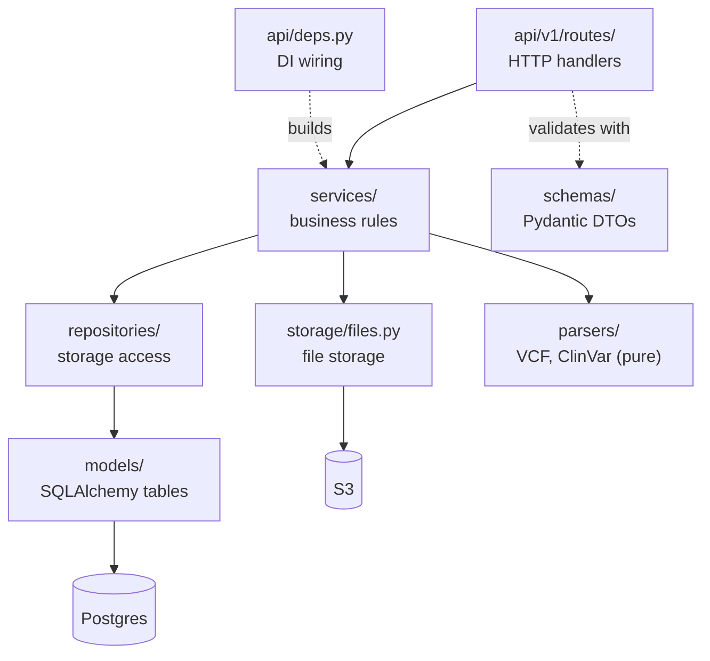
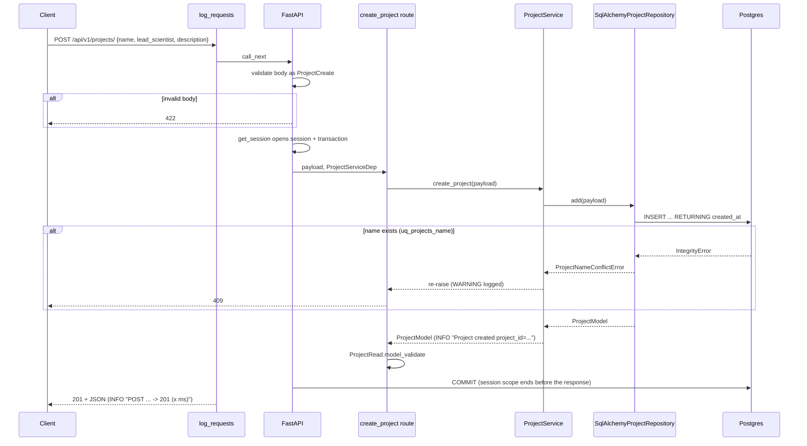
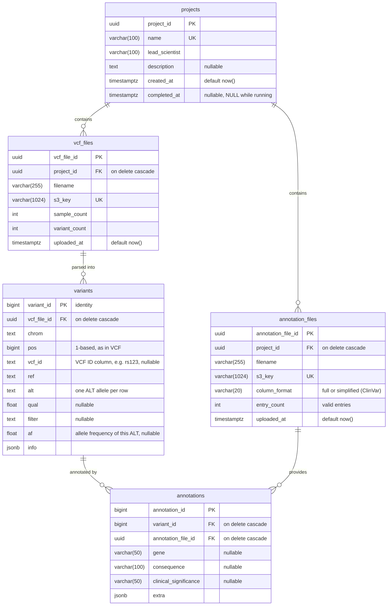

# Architecture: Genomic Variant Analysis Platform

Living document: update it in the same pull request as the change it describes.
Status markers: **[done]** implemented, **[planned]** designed but not built yet.

## 1. Overview

A REST API for genomic variant analysis. Users create projects, upload VCF files, the service parses
variants into Postgres, applies annotation files, and returns filtered variants and summaries.



| Component | Role | Status |
|---|---|---|
| FastAPI app in Docker | REST API | **[done]** week 1 |
| Postgres (local Docker) | Relational storage | **[done]** week 1 |
| GitHub Actions: lint, format, type check, tests | Quality gate on every push and PR | **[done]** week 1 |
| S3 file storage (moto server locally) | Raw uploaded files, referenced by `s3_key` | **[done]** week 2 |
| AWS S3 bucket | Production bucket (Terraform) | **[planned]** |
| AWS RDS Postgres | Managed production database | **[planned]** |
| ECR + ECS Fargate + ALB | Image registry, serverless containers, load balancer | **[planned]** |
| GitHub Actions: build, push, deploy | Continuous delivery | **[planned]** |

## 2. Tech stack

| Concern | Tool | Why |
|---|---|---|
| Language | Python 3.15 | Latest stable release; one version locally, in Docker and in CI |
| Web framework | FastAPI | Type hints drive validation, routing and OpenAPI docs (`/docs`) |
| Validation / DTOs | Pydantic v2, pydantic-settings | Request/response contracts; typed config from env |
| ORM | SQLAlchemy 2.0 async + asyncpg | Typed declarative models, non-blocking IO |
| Migrations | Alembic (async template) | Versioned, reviewable schema changes |
| Server | Uvicorn | ASGI server, app built by factory (`--factory`) |
| Dependencies | Poetry (`pyproject.toml`, `poetry.lock`, in-project `.venv`) | Reproducible installs |
| Tests | pytest, pytest-asyncio, pytest-cov, httpx | Async tests, in-process HTTP, 80% coverage gate |
| Quality | ruff (lint + format), mypy strict, pyright, pre-commit | Same checks locally and in CI |
| Containers | Docker multi-stage, Compose | Non-root runtime image; one-command local stack |
| CI/CD | GitHub Actions | Runs on every push and pull request |

## 3. Layers



Dependencies point one way: routes to services to repositories. Nothing imports "upwards".

| Package | Responsibility | Must not |
|---|---|---|
| `app/api/v1/routes/` | Map HTTP to service calls | import `repositories/` or `db/` |
| `app/api/v1/router.py` | Mount resource routers under `/api/v1` | contain handlers |
| `app/api/deps.py` | Build services and their dependencies (the "beans") | contain logic |
| `app/api/errors.py` | Map domain error base classes to HTTP status codes | know individual errors |
| `app/services/` | Business rules and orchestration of one use case | import FastAPI |
| `app/parsers/` | Pure functions: VCF and ClinVar validation and parsing | do IO, import other layers except `core/` |
| `app/storage/` | File storage (S3) behind a Protocol | import FastAPI, hold business rules |
| `app/repositories/` | Only code that reads/writes storage; DB errors to domain errors | import FastAPI, hold business rules |
| `app/schemas/` | API contract (what clients send and receive) | know about storage |
| `app/models/` | Table definitions | open sessions, run queries |
| `app/db/` | Engine lifecycle, one session per request | contain business rules |
| `app/core/` | Settings, logging, domain exceptions | import other `app` layers |
| `app/main.py` | Assemble the app (factory) | contain endpoint logic |

### Design patterns

| Pattern | Where | What it buys |
|---|---|---|
| Application Factory | `create_app(settings)` in `app/main.py` | Fresh, explicitly configured app per test; no import-time side effects |
| Layered architecture | routes, services, repositories | Each change touches one layer |
| Repository | `ProjectRepository`, `VcfFileRepository`, `AnnotationFileRepository` Protocols, each with a SQLAlchemy and an in-memory implementation; file repositories extend the generic `ProjectFileRepository[M]` | Storage swappable without touching services or routes |
| Strategy (via Protocol) | `FileStorage`: `S3FileStorage`, `InMemoryFileStorage` | Services and tests never need a real S3 |
| Service Layer | `ProjectService`, `VcfFileService`, `AnnotationFileService` | One home for multi-step use cases (validate, parse, insert rows, write S3) |
| Dependency Injection | `Annotated[..., Depends(...)]` in `app/api/deps.py` | Routes receive ready services; tests override one provider |
| Unit of Work | `get_session`: `session.begin()` per request, then `AfterCommit` actions | One transaction per request; S3 deletes run only after a successful commit |
| Decorator | `DeleteAfterCommitStorage` wraps any `FileStorage` | Services stay unaware that deletes are deferred |
| DTO | `ProjectCreate`, `ProjectRead`, `VcfFileRead`, `VcfFileDetail`, `AnnotationFileRead`; parser output `ParsedVariant` | Clients cannot set server-owned fields; `s3_key` never leaves the server |

SOLID in practice:
- Single responsibility: one job per layer (table above).
- Open/closed: a new resource adds new files (schema, model, repository, service, route) and one
  `include_router` line; existing resources do not change.
- Liskov substitution: both repositories satisfy the same Protocol; the service cannot tell them apart.
- Interface segregation: the repository Protocol lists only the operations the service uses.
- Dependency inversion: `ProjectService` depends on the `ProjectRepository` abstraction; only
  `api/deps.py` chooses the concrete class.

## 4. Directory layout

```text
app/
  main.py                    factory, lifespan, /health
  core/                      config.py, logging.py, exceptions.py
  db/                        base.py (Base + naming convention), session.py (engine, get_session)
  models/                    one module per table; __init__.py imports all of them
  schemas/                   one module per resource
  repositories/              one module per aggregate
  services/                  one module per resource / use case
  storage/                   files.py: FileStorage Protocol, S3 and in-memory implementations
  parsers/                   text.py (filename, gunzip), vcf.py, clinvar.py: pure functions
  api/uploads.py             read an upload with the size limit (413)
  api/deps.py
  api/v1/router.py
  api/v1/routes/             one module per resource
alembic/versions/            one revision per schema change
tests/unit/ tests/api/ tests/integration/
docs/                        week-NN-implementation.md guides
```

## 5. Request lifecycle

`POST /api/v1/projects/`:



1. Validation runs before any of our code; bad input never reaches the service.
2. One session and one transaction per request; any exception rolls everything back.
3. Domain errors are plain Python exceptions; `app/api/errors.py` maps each base class (not found, conflict, invalid input) to one status code.
4. Output always goes through a response schema, never a raw ORM object.

## 6. Data model

Target relational schema. Implemented: `projects` (week 1), `vcf_files`, `variants`, `annotation_files`
(week 2). `annotations` is planned.



| Table | Status | Constraints and indexes |
|---|---|---|
| `projects` | **[done]** | `pk_projects`, `uq_projects_name`; index on `created_at` once listing is paginated |
| `vcf_files` | **[done]** | `fk_vcf_files_project_id_projects` (cascade), `uq_vcf_files_s3_key`, `ix_vcf_files_project_id` |
| `variants` | **[done]** | FK to vcf_files (cascade); `ix_variants_vcf_file_id_variant_id` (paging, cascade); `ix_variants_chrom_pos` for region queries; no unique index on alleles (decision 16) |
| `annotation_files` | **[done]** | FK to projects (cascade), `uq_annotation_files_s3_key`, `ix_annotation_files_project_id` |
| `annotations` | **[planned]** | FKs to variants and annotation_files (cascade); unique (`variant_id`, `annotation_file_id`); index on `gene` |

Design decisions:
- File bytes live in S3; the database stores only metadata and `s3_key`. Rows stay small and
  backups stay cheap.
- `variants.variant_id` is `bigint` (identity), not UUID: a single VCF can hold millions of rows, and a
  sequential 8-byte key keeps the index compact. Resources clients address directly (projects,
  files) use UUIDs, which do not leak counts and can be generated anywhere.
- Multi-allelic VCF lines are split into one row per ALT allele, so (`chrom`, `pos`, `ref`, `alt`)
  identifies a variant within a file. The parser enforces it; a unique index cannot, because long
  indel alleles exceed the B-tree entry limit (about 2.7 KB).
- `af` has its own column (one value per ALT allele) because variants are filtered by it.
- Free text read from a VCF (`chrom`, `ref`, `alt`, ...) is `text`: no natural length limit, and
  Postgres stores `text` and `varchar` the same way.
- No `status` column on `vcf_files`: parsing is synchronous, so a row exists only for a parsed file.
- `info` and `extra` are `jsonb`: VCF INFO fields and annotation columns differ by caller and tool.
  Fields that become filters (for example `gene`, `consequence`) get their own columns.
- Enumerated values (`annotation_files.column_format`) are `VARCHAR` validated by a Python
  `StrEnum`, not native Postgres enums: adding a value is then an ordinary migration.
- Deleting a project cascades to its files, variants and annotations (`ON DELETE CASCADE`).
  `ProjectService` deletes the S3 objects under `projects/{project_id}/` once the delete has
  committed.
- S3 keys are built from ids only: `projects/{project_id}/vcf/{vcf_file_id}.vcf[.gz]` and
  `projects/{project_id}/annotation/{annotation_file_id}.txt[.gz]`.
- Column naming: snake_case; plural table names; primary key `<entity>_id` (`project_id`,
  `vcf_file_id`, ...), so a foreign key column has the same name as the key it references; no table
  prefix on other columns (`projects.name`, not `project_name`); timestamps end in `_at` and are
  `timestamptz`; booleans start with `is_`/`has_`. Rationale: guide step 5, "Naming conventions".
- All constraint names come from the naming convention in `app/db/base.py`.

## 7. REST API

| Method | Path | Success | Errors | Status |
|---|---|---|---|---|
| GET | `/health` | 200 `{"status": "ok"}` | | **[done]** |
| POST | `/api/v1/projects/` | 201 `ProjectRead` | 409 name exists, 422 | **[done]** |
| GET | `/api/v1/projects/` | 200 `list[ProjectRead]`, oldest first | | **[done]** |
| DELETE | `/api/v1/projects/{project_id}/` | 204 | 404, 422 bad UUID | **[done]** |
| GET | `/api/v1/projects/{project_id}/` | 200 | 404 | **[planned]** |
| POST | `/api/v1/projects/{project_id}/complete/` | 200, sets `completed_at` | 404, 409 already completed | **[planned]** |
| POST | `/api/v1/projects/{project_id}/vcf/` | 201 `VcfFileRead` + `Location`, multipart `file` | 404, 413, 422 | **[done]** |
| GET | `/api/v1/projects/{project_id}/vcf/` | 200 `list[VcfFileRead]` | 404 | **[done]** |
| GET | `/api/v1/projects/{project_id}/vcf/{vcf_id}?limit=&offset=` | 200 `VcfFileDetail` (metadata + variant page) | 404, 422 | **[done]** |
| DELETE | `/api/v1/projects/{project_id}/vcf/{vcf_id}` | 204 | 404 | **[done]** |
| POST | `/api/v1/projects/{project_id}/annotation/` | 201 `AnnotationFileRead`, multipart `file` | 404, 413, 422 | **[done]** |
| GET | `/api/v1/projects/{project_id}/annotation/` | 200 `list[AnnotationFileRead]` | 404 | **[done]** |
| DELETE | `/api/v1/projects/{project_id}/annotation/{annotation_id}` | 204 | 404 | **[done]** |
| GET | `/api/v1/vcf-files/{vcf_file_id}/variants/?chrom=&start=&end=&gene=&limit=&offset=` | 200 page | 404, 422 | **[planned]** |
| GET | `/api/v1/projects/{project_id}/summary/` | 200 counts by chrom, consequence, significance | 404 | **[planned]** |

Conventions: paths exactly as specified (collections end with a slash, week 2 item paths do not), `/api/v1` version prefix,
201 for create, 204 for delete, 404 for unknown ids, 409 for conflicts, 422 left to Pydantic.
Lists will get `limit`/`offset` pagination once they can grow large (variants first).

## 8. Cross-cutting concerns

### Configuration
Environment variables, read once by `Settings` (`app/core/config.py`); `.env` locally, ECS task
definition plus Secrets Manager in AWS.

| Variable | Required | Default | Notes |
|---|---|---|---|
| `DATABASE_URL` | yes | | `postgresql+asyncpg://...`; held as `SecretStr` |
| `LOG_LEVEL` | no | `INFO` | `DEBUG`, `INFO`, `WARNING`, `ERROR` |
| `TEST_DATABASE_URL` | tests only | `...localhost:5433/gva_test` | Integration tests |
| `S3_BUCKET` | no | `gva-files` | Bucket for uploaded files |
| `S3_ENDPOINT_URL` | no | none (AWS) | Local S3: `http://localhost:9000`, in Compose `http://s3:5000` |
| `AWS_REGION` | no | `us-east-1` | Read as `aws_region` |
| `MAX_UPLOAD_BYTES` | no | 52428800 (50 MB) | Upload limit (413); also caps `.gz` content after decompression |
| `AWS_ACCESS_KEY_ID`, `AWS_SECRET_ACCESS_KEY` | local only | | Read by boto3, never by `Settings`; fake values for moto; ECS uses the task role |

### Logging
- stdlib `logging`, configured once in the lifespan (`configure_logging`), output to stdout
  (collected by Docker and, later, CloudWatch).
- `log_requests` middleware: one line per request with method, path, status, duration; level INFO
  for 2xx/3xx, WARNING for 4xx, ERROR for 5xx.
- Services log state changes at INFO and rejected requests at WARNING; repositories log row-level
  detail at DEBUG.
- Never logged: request bodies, query strings, `DATABASE_URL`, credentials, file content,
  uploaded filenames. Parse errors log the line number and a fixed reason only.
- **[planned]** JSON log format and a request id for CloudWatch Logs Insights.

### Migrations
- Every schema change is an Alembic revision generated with `--autogenerate`, then reviewed by hand.
- Each revision must downgrade cleanly; CI runs `upgrade head`, `check`, `downgrade base`.
- In Docker Compose (and later ECS), a one-off `migrate` container runs `alembic upgrade head`
  before the API starts.

### Testing
| Layer | Scope | Storage |
|---|---|---|
| `tests/unit/` | schemas, services, in-memory repository | in memory |
| `tests/api/` | HTTP contract through the real app | in memory (dependency override) |
| `tests/integration/` | SQL repository, full stack with lifespan | Postgres `test_db`, rolled back per test |

Line coverage gate: 80% (`[tool.coverage.report] fail_under`), currently about 99% (191 tests).
S3 code is tested against moto in process; API and integration tests use `InMemoryFileStorage`.
Tests follow FIRST and Arrange, Act, Assert. Every endpoint has a happy-path test plus one test per
documented error status.

### CI/CD
| Stage | Tool | Status |
|---|---|---|
| Lint + format + whitespace/EOF | pre-commit (ruff, pre-commit-hooks) | **[done]** |
| Type check | mypy strict | **[done]** |
| Migrations up/check/down | Alembic against a Postgres service container | **[done]** |
| Tests + coverage gate + coverage artifact | pytest-cov | **[done]** |
| Build and push image | Docker, ECR | **[planned]** |
| Deploy | ECS service update, migrations as one-off task | **[planned]** |

## 9. Decision log

| # | Decision | Reason |
|---|---|---|
| 1 | Poetry for dependencies, in-project `.venv` | Course requirement; lock file for reproducible installs |
| 2 | Routes, services, repositories as separate layers | Business logic for VCF/S3 workflows needs a home that is neither HTTP nor SQL |
| 3 | Repository as `Protocol` with an in-memory implementation | Fast, DB-free unit and API tests; storage can change without touching services |
| 4 | `/api/v1` prefix around the specified paths | Room for a breaking v2 without breaking v1 clients |
| 5 | UUID keys for client-facing resources, bigint for variants | Non-guessable public ids; compact index for millions of variant rows |
| 6 | Uniqueness enforced by DB constraints, mapped to 409 (`projects.name` now, `s3_key` later) | No race between "check" and "insert" |
| 7 | Settings injected into `create_app` | Tests never depend on `.env`; no import-time side effects |
| 8 | Python 3.15, the latest stable release | Same version locally, in Docker and in CI |
| 9 | Parse uploads synchronously, 201, no status column | KISS for files up to 50 MB; a queue can come when needed |
| 10 | Upload: flush rows, then write S3. Delete: delete rows, commit, then delete S3 (`AfterCommit`) | No row ever points at a missing file; the only leftover case is a harmless orphaned object, logged at ERROR |
| 11 | One `variants` row per ALT allele with its own `af` | (`chrom`, `pos`, `ref`, `alt`) identifies a variant; AF filters are plain SQL |
| 12 | Hand-written VCF and ClinVar parsers | No C extensions; explicit, tested rules with line numbers in errors |
| 13 | ClinVar full format = `AlleleID` first, at least 32 columns, required columns present | NCBI appends columns over time (40 in 2026); the simplified 12-column format is exact |
| 14 | Local S3 is moto server | MinIO stopped publishing Docker images; moto is also the test fake |
| 15 | Decompression capped at `MAX_UPLOAD_BYTES`, all gzip members read | Gzip bomb protection; bgzip files have many members |
| 16 | No unique constraint on (`vcf_file_id`, `chrom`, `pos`, `ref`, `alt`) | Long indel alleles exceed the B-tree entry limit; the parser rejects duplicates |
| 17 | Parsing runs in `asyncio.to_thread` | CPU work must not block the event loop |
| 18 | `Content-Length` checked in a middleware before the body is read | Starlette spools multipart bodies to disk before the route runs |

## 10. Changelog by week

### Week 1
Project skeleton, Poetry, Docker and Compose (db, test_db, migrate, api), settings, logging,
`projects` table (`project_id`, `name`, `lead_scientist`, `description`, `created_at`,
`completed_at`) and first migration, `POST`/`GET`/`DELETE` projects endpoints, unit/API/integration
tests (coverage about 98%), pre-commit, GitHub Actions CI.

### Week 2
`vcf_files`, `variants`, `annotation_files` tables and migration; VCF parser (multi-allelic split,
AF per allele, gzip/bgzip) and ClinVar parser (full and simplified formats); S3 file storage with
moto server in Compose; VCF upload/list/get/delete and annotation upload/list/delete endpoints;
project and file deletes remove S3 objects after the commit; 191 tests, coverage about 99%.
