# Week 2: VCF and ClinVar annotation file endpoints

Goal: upload VCF files into a project, parse and validate them, store every variant (with its
allele frequency) in Postgres and the raw file in S3; upload ClinVar annotation files, validate
them and count their valid entries; list, read and delete both kinds of file.
Read [ARCHITECTURE.md](../ARCHITECTURE.md) first and finish
[week 1](week-01-implementation.md); this guide builds on that code.

This guide explains the design with diagrams, tables and references to the files, classes and
functions on the `week_2_implementation` branch. It does not repeat the code: open the file next
to the step, read it, then write your own version. Run the check at the end of each step and
commit once the step works.

## Task coverage

| Course task | Where |
|---|---|
| 5 `POST /projects/{project_id}/vcf/`: upload a VCF file | Steps 9 and 10 |
| 5 Validate file extension (.vcf or .vcf.gz) | Step 3 (`file_extension`) |
| 5 Parse and validate the VCF file | Step 4 |
| 5 Store metadata in the database | Steps 6 and 8 (`vcf_files`) |
| 5 Extract all variants into the variants table | Steps 4, 6, 8 (`variants`, batched insert) |
| 5 Extract AF from INFO and store it in the variants table | Step 4 (`_allele_frequencies`), step 6 (`variants.af`) |
| 5 `GET /projects/{project_id}/vcf/`: list VCF files | Steps 9 and 10 |
| 5 `GET /projects/{project_id}/vcf/{vcf_id}`: metadata and variants | Steps 9 and 10 (paged) |
| 5 `DELETE /projects/{project_id}/vcf/{vcf_id}`: file and all its data | Steps 9 and 10 (cascade + S3) |
| 6 `POST /projects/{project_id}/annotation/`: upload a ClinVar file | Steps 9 and 10 |
| 6 Full (32 or more columns) and simplified (12 columns) tab-separated format | Step 5 |
| 6 Validate the format and count valid entries | Step 5 |
| 6 Store the file and save metadata | Steps 7 to 9 |
| 6 `GET /projects/{project_id}/annotation/`: list annotation files | Steps 9 and 10 |
| 6 `DELETE /projects/{project_id}/annotation/{annotation_id}` | Steps 9 and 10 |
| Rubric: logging, 80% coverage, FIRST tests | Step 9 (logging), step 12 (tests) |

## Definition of done

- [ ] `docker compose up --build` starts db, local S3, runs migrations, serves the API on :8000
- [ ] All seven new endpoints return the documented status codes
- [ ] Uploading a `.vcf` or `.vcf.gz` file stores one `variants` row per ALT allele, with `af`
- [ ] Deleting a VCF file, an annotation file or a project removes its rows and its S3 objects
- [ ] `alembic upgrade head`, `alembic check`, `alembic downgrade base` all run cleanly
- [ ] `poetry run python scripts/check.py` passes (coverage at least 80%)
- [ ] GitHub Actions is green on push and on pull request

## Design decisions for this week

| Decision | Why |
|---|---|
| Parse synchronously inside the upload request, return 201 | KISS: files are capped at 50 MB; a job queue can come later if uploads grow |
| Parsing runs in a worker thread (`asyncio.to_thread`) | It is CPU work; on the event loop it would stall every other request, health checks included |
| No `status` column on `vcf_files` | A row exists only after a successful parse, so it could only ever say "parsed" |
| Raw file in S3, metadata and variants in Postgres | Rows stay small; the original file is kept for re-processing |
| S3 key built by the server: `projects/{project_id}/vcf/{vcf_file_id}.vcf.gz` | A client filename never becomes a path; deleting a project is one prefix delete |
| Upload: rows are written (flushed) before the S3 object | If S3 fails, the transaction rolls back and nothing is half-saved |
| Delete: S3 objects are removed only after the commit (`AfterCommit`) | If the commit fails, rows and files both survive; a database row never points at a missing file |
| No unique constraint on (`vcf_file_id`, `chrom`, `pos`, `ref`, `alt`) | A B-tree entry is limited to about 2.7 KB and long indel alleles exceed it; the parser rejects duplicates |
| Oversized bodies are refused from the `Content-Length` header | Starlette writes a multipart body to a temp file before the route runs; checking afterwards would let a 20 GB upload fill the disk |
| A multi-allelic line becomes one row per ALT allele, each with its own AF | (`chrom`, `pos`, `ref`, `alt`) then identifies a variant; filtering by AF is a plain `WHERE` |
| Hand-written parser, no pysam/cyvcf2 | No C extension to install; the format rules are explicit and tested |
| Annotation upload stores the file and metadata only | The task asks to validate and count; matching entries to variants is a later week |
| Local S3 is moto server in Docker Compose | MinIO no longer publishes Docker images; moto is already the test fake, so one tool covers both |
| Domain errors map to HTTP in one place (`app/api/errors.py`) | Routes stay free of `try/except`; every error body has the same shape |
| VCF and annotation files share one generic repository, model mixin and schema base | Two file types already repeat the same code; a third one only adds what differs |

### The ClinVar formats

NCBI publishes `variant_summary.txt.gz` at
https://ftp.ncbi.nlm.nih.gov/pub/clinvar/tab_delimited/. Its header starts with `#AlleleID`. The
course calls it the "32-column" format, but NCBI adds columns at the end over time (the README
lists 40 in 2026), so the parser accepts any header that starts with `AlleleID`, has at least 32
columns and contains the columns the service needs.

The simplified format is defined by this project: exactly the 12 tab-separated columns in
`SIMPLIFIED_COLUMNS` (`app/parsers/clinvar.py`), from `AlleleID` to `AlternateAlleleVCF`.

A row is a valid entry when it has as many fields as the header, a positive integer `AlleleID`, a
known `Chromosome` (not empty, `na` or `-`) and positive integer `Start <= Stop`. Invalid rows are
counted and logged, not fatal; a file with no valid entry is rejected.

## Prerequisites

Week 1 done and green. Same tools as week 1: Python 3.15, Poetry 2.x, Docker with Compose v2.

## The big picture

One upload request travels through every layer once. Each box is one file; the step that builds
it is in brackets.

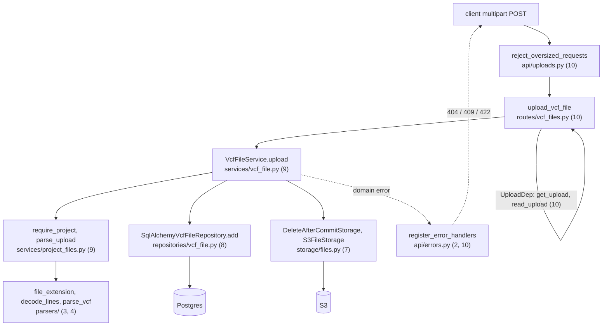

What is shared between the two file types, and what each adds:

| Layer | Shared (written once) | VCF only | Annotation only |
|---|---|---|---|
| Parsers | `parsers/text.py`: `file_extension`, `decode_lines` | `parsers/vcf.py` | `parsers/clinvar.py` |
| Models | `models/project_file.py`: `ProjectFileMixin` | `VcfFileModel`, `VariantModel` | `AnnotationFileModel` |
| Schemas | `schemas/project_file.py`: `ProjectFileRead` | `VcfFileRead`, `VariantRead`, `VcfFileDetail` | `AnnotationFileRead` |
| Repositories | `repositories/project_file.py`: `ProjectFileRepository[M]` + SQL and in-memory bases | `add` with variants, `list_variants` | `add` |
| Services | `services/project_files.py`: `require_project`, `require_file`, `parse_upload` | `VcfFileService` | `AnnotationFileService` |
| API | `api/uploads.py`, `api/errors.py`, `UploadDep` in `api/deps.py` | `routes/vcf_files.py` | `routes/annotation_files.py` |

---

## Step 1. Dependencies

```bash
poetry add python-multipart boto3
poetry add --group dev "boto3-stubs[s3]" "moto[s3]"
```

Then widen the `python-multipart` pin Poetry wrote for a `0.0.x` version, so patch releases
(security fixes) can still install: `"python-multipart (>=0.0.34,<0.1.0)"`, then `poetry lock`.

| Package | Why |
|---|---|
| python-multipart | FastAPI needs it to read `multipart/form-data` file uploads (`UploadFile`) |
| boto3 | AWS SDK, S3 client |
| boto3-stubs[s3] | Type hints for the S3 client, so mypy strict checks every call |
| moto[s3] | In-process fake of AWS used by the S3 storage tests, and the local S3 server |

## Step 2. Settings and domain errors

### Settings

`app/core/config.py`, class `Settings`, gains four fields:

| Field | Default | Purpose |
|---|---|---|
| `s3_bucket` | `gva-files` | Bucket for raw files |
| `s3_endpoint_url` | `None` | `None` on AWS (boto3 finds the regional endpoint); the local S3 container in development |
| `aws_region` | `us-east-1` | Region for the S3 client |
| `max_upload_bytes` | 50 MiB | Caps the upload and, for `.gz` files, the decompressed content too |

Credentials are deliberately not settings: boto3 reads them from its default chain (environment
variables locally, the ECS task role on AWS), so they never sit in a `Settings` object that could
be logged. `.env.example` adds `S3_BUCKET`, `S3_ENDPOINT_URL=http://localhost:9000` and fake
`AWS_ACCESS_KEY_ID` / `AWS_SECRET_ACCESS_KEY` (moto accepts any; never put real keys there).

### Domain errors

`app/core/exceptions.py` defines a small hierarchy. Services and repositories raise the leaves;
the API layer only knows the three middle classes (step 10).

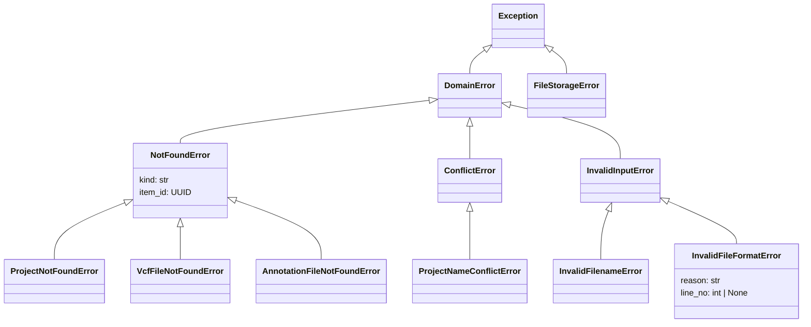

- `NotFoundError.__init__` builds the message once from the class attribute `kind`, so each
  "not found" leaf is two lines: the class and its `kind` (for example `"VCF file"`).
- `DomainError` means "the client caused it, the message is safe to return". `FileStorageError`
  is deliberately outside it: S3 refusing an operation is our problem, so it stays a 500.
- `FileStorageError` wraps boto3 errors, so code above the storage layer never imports botocore.
- `InvalidFileFormatError` keeps `reason` and `line_no` as attributes, so services can log them as
  structured fields. Its message names the rule that failed, never the offending content: a VCF
  line can hold patient data, and the message goes into the HTTP response and the log.

## Step 3. Shared parsing helpers

Both parsers need the same two things: check the filename and turn bytes (maybe gzip) into text
lines. They live once in `app/parsers/text.py`. Parsers are pure functions: no database, no S3,
no FastAPI, so they are tested with plain strings in microseconds. Create the packages
`app/parsers/` and `app/storage/` (each with an empty `__init__.py`).

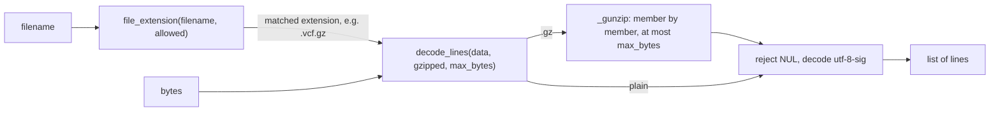

- `file_extension` is case-insensitive and also caps the filename length at
  `MAX_FILENAME_LENGTH`, the width of the `filename` column. Failure: `InvalidFilenameError`.
- Gzip bombs: a 50 KB `.gz` file can expand to gigabytes. `zlib.decompressobj().decompress(data,
  max_length)` stops after `max_length` bytes, so memory stays bounded.
- bgzip, the tool `bcftools` and `tabix` use, writes a `.vcf.gz` as many gzip members back to back.
  `unused_data` holds the bytes after the current member, so the loop in `_gunzip` reads them all.
- Postgres cannot store the NUL character in `text` or `jsonb`; rejecting it here turns a would-be
  500 into a 422.
- `utf-8-sig` decodes UTF-8 and drops a byte order mark if there is one (Excel and other Windows
  tools write it); otherwise the first line would not start with `##fileformat` or `AlleleID`.

## Step 4. VCF parser

A VCF file has meta lines (`##...`), one header line, then one tab-separated record per line:

```text
##fileformat=VCFv4.2
#CHROM  POS  ID   REF  ALT  QUAL  FILTER  INFO
chr1    100  rs1  A    G    50    PASS    AF=0.25;DP=10
chr2    200  .    C    T,A  .     .       AF=0.1,0.2;DB
```

`.` means "missing". `ALT` may list several alleles; then `AF` lists one frequency per allele, in
the same order. `DB` (no `=`) is a flag. Columns after `INFO` (`FORMAT` and one per sample) are
optional; this week only counts the samples.

`app/parsers/vcf.py`, call graph:

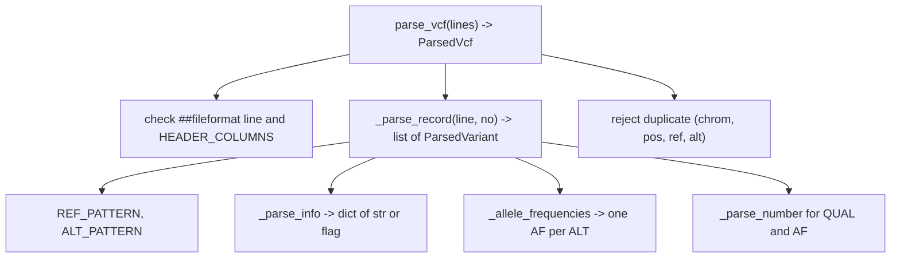

- `ParsedVcf` holds `sample_count` and `variants`. `ParsedVariant` is a frozen dataclass with
  `slots=True`: immutable and small, which matters when a file has hundreds of thousands of
  variants. Its fields have the same names as the `variants` columns, so `asdict(variant)` is
  ready to insert.
- Every rejection raises `InvalidFileFormatError` with the line number, so the user can fix the
  file; the last sample line above becomes two `ParsedVariant`s (`T` with AF 0.1, `A` with AF 0.2).
- `zip(..., strict=True)` documents that alleles and frequencies always have the same length
  (checked just before); a bug would fail loudly instead of dropping alleles.
- `float()` accepts `"nan"` and `"inf"`, which are not valid numbers in a VCF and not valid JSON;
  `_parse_number` rejects them with `math.isfinite`.
- A reference-only line (`ALT` is `.`) carries no variant and is skipped, not rejected.
- `AF=.` is one missing value for all alleles (the VCF specification allows a single `.` for a
  missing list), so it becomes `None` for each allele instead of failing the length check.
- `ALT_PATTERN` accepts bases, `*`, symbolic alleles (`<DEL>`) and the breakends written by
  structural variant callers (`G]17:198982]`, `.A`).
- Duplicates (same `CHROM`, `POS`, `REF`, `ALT`) are rejected here, the only place they are
  checked (step 6 explains why the database does not).

## Step 5. ClinVar parser

`app/parsers/clinvar.py`: `parse_clinvar(lines) -> ClinVarSummary`.

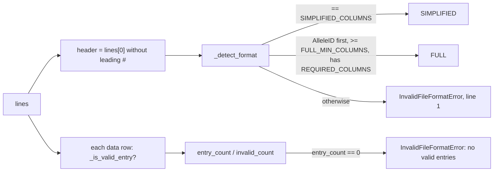

- `ClinVarFormat` is a `StrEnum`: stored as the plain string `"full"` or `"simplified"`, and the
  response schema still only allows those two values.
- `removeprefix("#")` accepts the header with or without NCBI's leading `#`.
- `_is_valid_entry` looks columns up by name (`column` dict), so it works for both formats.
- Bad rows are counted, not fatal: real ClinVar releases contain rows without coordinates (for
  example `Start` = `-1`). Only a file with zero valid entries is rejected.

## Step 6. Models and the migration

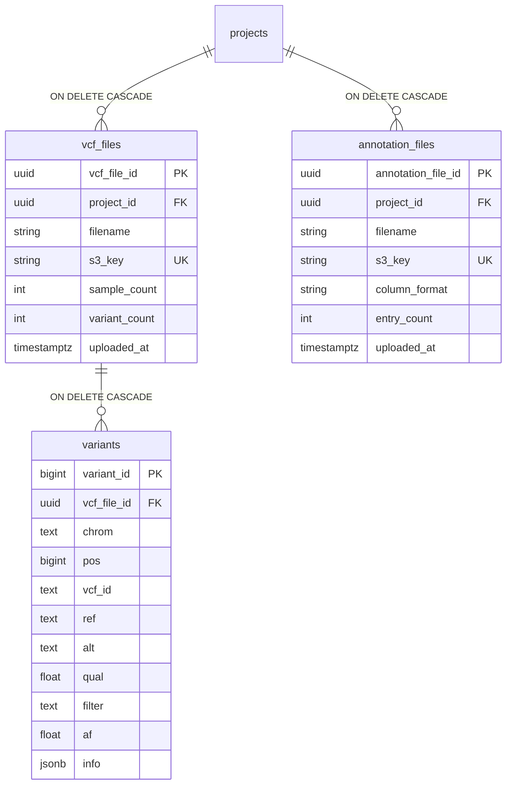

Indexes: `project_id` on both file tables, (`vcf_file_id`, `variant_id`) and (`chrom`, `pos`) on
`variants`.

Files to write:

| File | Contents |
|---|---|
| `app/models/project_file.py` | `ProjectFileMixin`: the four columns both file tables share (`project_id` FK with index, `filename`, unique `s3_key`, `uploaded_at` with `server_default=func.now()`) |
| `app/models/vcf_file.py` | `VcfFileModel(ProjectFileMixin, Base)` with its id and counts; `VariantModel` with the two `Index` objects in `__table_args__` |
| `app/models/annotation_file.py` | `AnnotationFileModel(ProjectFileMixin, Base)` with its id, `column_format`, `entry_count` |
| `app/models/__init__.py` | Import every model, so Alembic sees all tables through `Base.metadata` |

- `ProjectFileMixin` is a plain class, not a table: SQLAlchemy copies its `mapped_column`s into
  each model that inherits it. The generated tables are identical to writing the columns twice.
- Each file model keeps its own primary key name (`vcf_file_id`, `annotation_file_id`), because
  the API and the URLs use those names. `file_id = synonym("vcf_file_id")` adds a second name for
  the same column, which the generic repository (step 8) uses in queries and on objects. The mixin
  declares `file_id: Mapped[UUID]` under `TYPE_CHECKING` only, so mypy knows every file model has
  it while SQLAlchemy does not try to create a column for it.
- `ON DELETE CASCADE`: deleting a project deletes its files, deleting a VCF file deletes its
  variants, in one statement inside Postgres. No relationship or loop in Python is needed.
- `variant_id` is `bigint` with `Identity()`: a file can hold millions of variants, and a
  sequential 8-byte key keeps the index small. Files keep UUIDs because clients address them.
- Free text from the file (`chrom`, `ref`, `alt`, ...) is `Text`: Postgres stores `text` and
  `varchar` the same way, and an indel allele has no natural length limit.
- `qual` and `af` are `Mapped[float | None]`: SQLAlchemy maps them to double precision.
- `info` is `jsonb`: INFO keys differ between variant callers, so they do not get columns. `af`
  does get its own column because the platform filters on it.
- No unique constraint on (`vcf_file_id`, `chrom`, `pos`, `ref`, `alt`), although that is the
  natural key. Postgres limits one B-tree index entry to about 2.7 KB, and a structural deletion
  can have a REF allele of several kilobases: the insert would fail with "index row size exceeds
  btree maximum" and the upload would be a 500. The parser enforces uniqueness instead.
- Index (`vcf_file_id`, `variant_id`) serves both "one page of this file's variants, in file
  order" (step 8) and the cascade delete, which looks variants up by `vcf_file_id`.

Generate, read, and test the migration:

```bash
docker compose up -d db
poetry run alembic revision --autogenerate -m "create vcf and annotation tables"
poetry run alembic upgrade head
poetry run alembic check        # No new upgrade operations detected.
poetry run alembic downgrade base
poetry run alembic upgrade head
```

Read the generated file before you commit it: three `create_table` calls in dependency order
(`annotation_files`, `vcf_files`, then `variants`), the indexes, and a `downgrade` that drops them
in reverse. Remove the "commands auto generated" comment lines.

## Step 7. Schemas and file storage

### Schemas

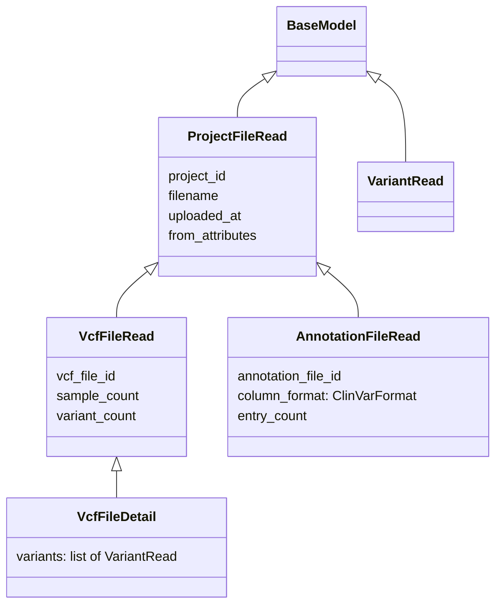

Files: `app/schemas/project_file.py`, `app/schemas/vcf_file.py`, `app/schemas/annotation_file.py`.
`s3_key` is not part of any response: it is an internal detail, and clients reach files only
through the API.

### File storage

`app/storage/files.py`:

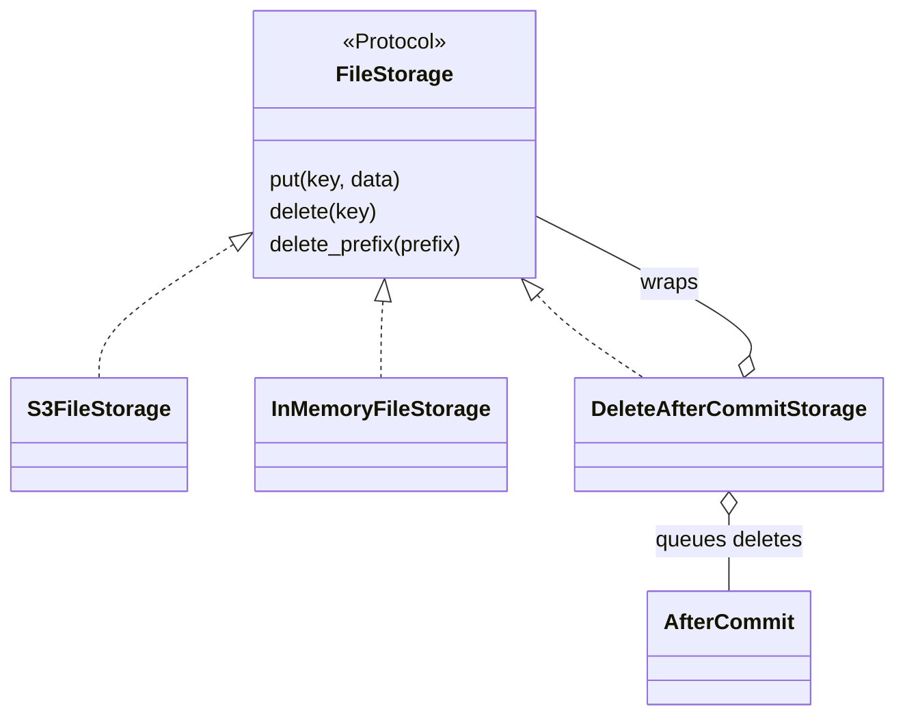

| Name | Role |
|---|---|
| `project_prefix(project_id)`, `object_key(project_id, kind, file_id, extension)` | Build keys from ids only. A filename like `../../etc/passwd` stays plain text in the `filename` column and never touches a path |
| `S3FileStorage` | boto3 behind the Protocol; every call runs in `asyncio.to_thread` because boto3 is blocking |
| `InMemoryFileStorage` | A dict, for unit and API tests |
| `DeleteAfterCommitStorage` | Decorator: `put` passes through, `delete` and `delete_prefix` are queued on `AfterCommit` |
| `build_file_storage(settings)` | One S3 client per process, created in the lifespan (step 10); no network call until first use |

- Same pattern as the repositories: services depend on the Protocol only (Dependency Inversion),
  so service and API tests run without S3.
- `mypy_boto3_s3` is imported under `TYPE_CHECKING` only, because the stubs are a dev dependency
  and are not installed in the Docker image. Python 3.14+ evaluates annotations lazily, so the
  annotation `S3Client` needs no quotes.
- `S3FileStorage` turns boto3 errors into `FileStorageError`. `delete_objects` needs an extra
  check: when some keys cannot be deleted it still answers HTTP 200 and lists them under
  `Errors`, so ignoring the response would report success for objects that are still there.
- A delete that fails after the commit is logged at ERROR by `DeleteAfterCommitStorage._run` and
  not raised: the client's delete has succeeded and only an orphaned object (no row points to it)
  is left.

### Unit of work: actions after the commit

`app/db/unit_of_work.py` holds `AfterCommit` (`add(action)`, `run()`) and the dependency
`get_after_commit`. `app/db/session.py`, function `get_session`, runs the queued actions once the
transaction has committed:

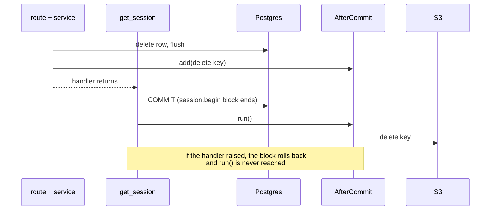

- `get_after_commit` returns a new `AfterCommit`, and FastAPI calls a dependency once per request
  and reuses the result, so `get_session` and `get_file_storage` receive the same instance.
- The session dependency uses `scope="function"` (week 1), so the commit and the S3 deletes both
  finish before the response is sent.

## Step 8. Repositories

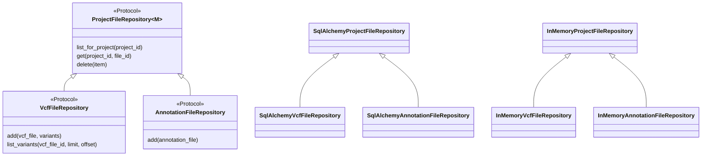

`app/repositories/project_file.py` holds the generic part, parametrized by the model type
`M: ProjectFileMixin`:

| Class | What it implements |
|---|---|
| `ProjectFileRepository[M]` | The Protocol services depend on |
| `SqlAlchemyProjectFileRepository[M]` | `list_for_project`, `get`, `delete`, and `_insert` (add + flush). A subclass only sets the class attribute `model` |
| `InMemoryProjectFileRepository[M]` | The same methods over a dict of dicts (project id, then file id); `_insert` stamps `uploaded_at` the way Postgres would |

`app/repositories/vcf_file.py` and `app/repositories/annotation_file.py` keep only what differs:
`add` (which calls `_insert`), and for VCF `list_variants` plus the variant storage.

- `get(project_id, file_id)` filters on both ids: a file id that belongs to another project is
  "not found" (404), so one project cannot read another project's files by guessing ids.
- The generic queries use `self.model.project_id`, `self.model.file_id` (the synonym from step 6)
  and `self.model.uploaded_at`, so one implementation serves every file table.
- `SqlAlchemyVcfFileRepository.add` inserts variants with `insert(VariantModel)` and a list of
  dicts, which SQLAlchemy sends as a few multi-row `INSERT` statements instead of one statement
  per row. Batches of `INSERT_BATCH_SIZE` (5000) bound the memory used for the parameter dicts.
  Variants are not added as ORM objects because tracking hundreds of thousands of objects in the
  session is slow and useless here.
- `InMemoryVcfFileRepository` assigns `variant_id` from a counter like the database identity, and
  overrides `delete` to drop the file's variants too (the cascade Postgres does for real).
- `list_variants` orders by `variant_id`, which is file order, so `limit` and `offset` pages are
  stable.

## Step 9. Services

`app/services/project_files.py` holds the steps every file service repeats:

| Function | Does | Raises |
|---|---|---|
| `require_project(projects, project_id)` | Load the project or log a WARNING | `ProjectNotFoundError` |
| `require_file(projects, files, project_id, file_id, not_found)` | `require_project`, then `files.get`, or log a WARNING | the `not_found` class passed in, e.g. `VcfFileNotFoundError` |
| `parse_upload(project_id, filename, data, extensions, parse, max_bytes)` | `file_extension`, then decode and `parse` in a worker thread; logs a WARNING with `line` and `reason` on rejection | `InvalidFilenameError`, `InvalidFileFormatError` |

`parse_upload` is generic: it takes the parser function (`parse_vcf` or `parse_clinvar`) and
returns `(extension, parsed)` with the parser's own result type.

The services then read as a list of use cases:

| Service (file) | Methods |
|---|---|
| `ProjectService` (`services/project.py`) | `create_project`, `list_projects`, `delete_project` (now also `storage.delete_prefix(project_prefix(...))`, since the cascade only covers database rows) |
| `VcfFileService` (`services/vcf_file.py`) | `upload`, `list_vcf_files`, `get_vcf_file`, `delete_vcf_file` |
| `AnnotationFileService` (`services/annotation_file.py`) | `upload` (also warns about `invalid_count`), `list_annotation_files`, `delete_annotation_file` |

The upload use case, in order:

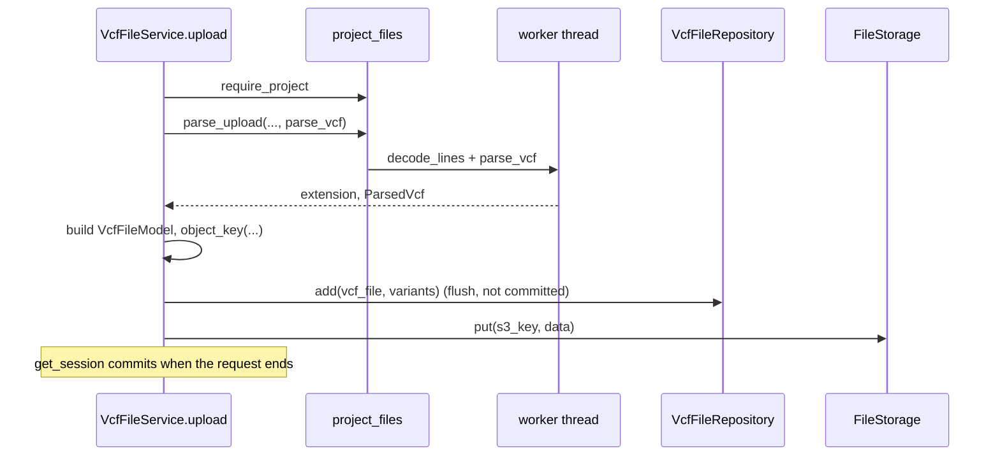

| # | Step | On failure |
|---|---|---|
| 1 | Project exists | `ProjectNotFoundError`, 404 |
| 2 | Filename has an allowed extension | `InvalidFilenameError`, 422 |
| 3 | Decode (gunzip, UTF-8) and parse | `InvalidFileFormatError` with line number, 422 |
| 4 | Insert metadata and variants (flush, not yet committed) | database error, 500, rolled back |
| 5 | Write the raw file to S3 | S3 error, 500, step 4 rolled back |
| 6 | Commit when the request ends (`get_session`) | 500; the S3 object is orphaned but harmless |

Step 3 runs in a worker thread (`asyncio.to_thread` inside `parse_upload`): unzipping and parsing
a 50 MB file is CPU work that would otherwise block the event loop for seconds. With the GIL the
thread does not make parsing faster, but Python switches threads every few milliseconds, so the
loop keeps answering other requests and `/health`.

Deletes are the other way round: the rows are deleted (flushed) at once, the S3 objects only
after the commit, through `DeleteAfterCommitStorage` (step 7). If the commit fails, rows and files
both survive, so the database never points at a missing file.

Logging, as set up in week 1:

| Level | Example | Never |
|---|---|---|
| INFO | `VCF file uploaded vcf_file_id=... project_id=... variants=3 samples=0 bytes=137` | file content, filenames |
| WARNING | `Upload rejected: project_id=... line=4 reason=POS must be a positive integer` | the line itself |
| DEBUG | `Inserted 5000 variant rows vcf_file_id=...`, `Stored object key=... bytes=...` | |
| ERROR | the request log line of a 500 (for example S3 unreachable) | credentials |

`reason` is one of the parser's fixed messages, never text from the file. Filenames are not logged
either: users name files after patients or samples.

## Step 10. Routes, uploads, errors and dependency injection

### Upload size checks: `app/api/uploads.py`

Two checks, both in the API layer because a status code is an HTTP concern:

| Name | When | How |
|---|---|---|
| `reject_oversized_requests` (middleware) | Before the body is read | 413 from the `Content-Length` header alone, allowing `MULTIPART_OVERHEAD_BYTES` (64 KB) for the multipart framing |
| `read_upload(file, max_bytes) -> Upload` | Inside the request | Reads `max_bytes + 1` bytes: enough to know a file is too large without reading all of it. Also covers bodies sent in chunks without `Content-Length`. Returns the frozen dataclass `Upload(filename, data)` |

The middleware is needed because Starlette parses a multipart body, and writes the file to a
temporary file, before the route function runs, so a check inside the route comes too late to
protect the disk.

### Dependency injection: `app/api/deps.py`

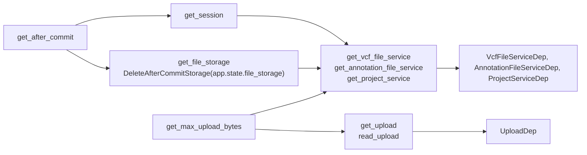

`deps.py` is still the only place that picks concrete classes (`SqlAlchemy...Repository`,
`DeleteAfterCommitStorage`). `UploadDep` lets a route receive the checked file as one parameter
instead of `UploadFile` plus the size limit.

### Error mapping: `app/api/errors.py`

`STATUS_BY_ERROR` maps the three base classes from step 2 to status codes, and
`register_error_handlers(app)` registers one handler per entry with `app.add_exception_handler`.
Each handler answers `{"detail": str(exc)}`.

| Base class | Status | Leaves |
|---|---|---|
| `NotFoundError` | 404 | project, VCF file, annotation file not found |
| `ConflictError` | 409 | project name taken |
| `InvalidInputError` | 422 | bad filename, bad file content |

FastAPI picks the handler of the closest base class, so a new leaf error (for example a future
`BamFileNotFoundError`) needs no change here. This is FastAPI's recommended way to translate
domain errors: services stay free of HTTP, routes stay free of `try/except`, and errors raised
inside dependencies are covered too.

### Routes

| File | Handlers |
|---|---|
| `app/api/v1/routes/vcf_files.py` | `upload_vcf_file`, `list_vcf_files`, `get_vcf_file`, `delete_vcf_file` |
| `app/api/v1/routes/annotation_files.py` | `upload_annotation_file`, `list_annotation_files`, `delete_annotation_file` |
| `app/api/v1/router.py` | Includes both new routers next to `projects` |

Each handler is one service call plus `Schema.model_validate(...)`; no `try/except`. The return
annotation is the response model, so `response_model=` is not repeated in the decorator.

`app/main.py`, function `create_app`: add `reject_oversized_requests` as middleware before
`log_requests` (the middleware added last runs first, so the access log still sees every 413),
then call `register_error_handlers(app)`. The
`lifespan` builds the S3 storage once with `build_file_storage(settings)` and stores it on
`app.state.file_storage`.

| Method | Path | Success | Errors |
|---|---|---|---|
| POST | `/api/v1/projects/{project_id}/vcf/` (multipart field `file`) | 201 `VcfFileRead` + `Location` | 404 project, 413 too large, 422 bad name or content |
| GET | `/api/v1/projects/{project_id}/vcf/` | 200 `list[VcfFileRead]` | 404 project |
| GET | `/api/v1/projects/{project_id}/vcf/{vcf_id}?limit=100&offset=0` | 200 `VcfFileDetail` | 404, 422 bad UUID or paging |
| DELETE | `/api/v1/projects/{project_id}/vcf/{vcf_id}` | 204 | 404 |
| POST | `/api/v1/projects/{project_id}/annotation/` (multipart field `file`) | 201 `AnnotationFileRead` | 404, 413, 422 |
| GET | `/api/v1/projects/{project_id}/annotation/` | 200 `list[AnnotationFileRead]` | 404 |
| DELETE | `/api/v1/projects/{project_id}/annotation/{annotation_id}` | 204 | 404 |

- Paths are exactly as the task specifies: collection paths end with a slash, item paths do not.
- `UploadFile` (inside `get_upload`) makes FastAPI read the `file` field of a
  `multipart/form-data` body; a request without it is a 422 before our code runs.
- The upload sets `Location` to the URL of the new resource (REST convention for 201), built with
  `request.url_for("get_vcf_file", ...)` from the name of the GET route, so the two cannot drift
  apart.
- `limit` is between 1 and 1000: a VCF can hold millions of variants, and one response must not.
- `ProjectNotFoundError` and the file-not-found errors both map to 404: from the client's view
  the resource at that path does not exist either way. The `detail` says which one.

## Step 11. Docker Compose: local S3

`docker-compose.yml` adds two services and one shared block:

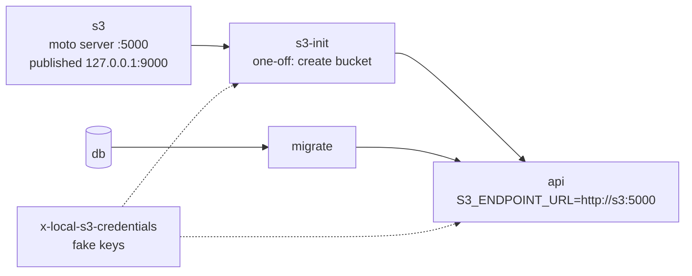

- `s3` runs moto in server mode. It keeps objects in memory: they are gone after
  `docker compose down`, while Postgres keeps its rows in a volume. Deleting such a file later
  still works, because an S3 delete of a missing key succeeds.
- `s3` starts through `scripts/moto_server.py` (mounted read-only) instead of the image's
  `moto_server`: `AccessLogRequestHandler` replaces the werkzeug access line with the API format,
  `GET /moto-api/ -> 200 (0.5 ms)` under logger `moto.request`, without query strings, 4xx at
  WARNING and 5xx at ERROR.
- `s3-init` is a one-off container that creates the bucket, like `migrate` for the schema; `api`
  waits until both have exited successfully.
- `x-local-s3-credentials` holds fake keys (moto accepts any) and is merged only into `api` and
  `s3-init`; `migrate` never talks to S3 and does not get them. On AWS no keys exist at all: the
  ECS task role provides temporary credentials.

### Test data for trying it by hand

Tests never read files from disk (step 12). For manual tries, `scripts/generate_test_datasets.sh`
builds a set of files into the git-ignored `datasets/` folder (also in `.dockerignore`), so real
data never reaches the repository or the image.

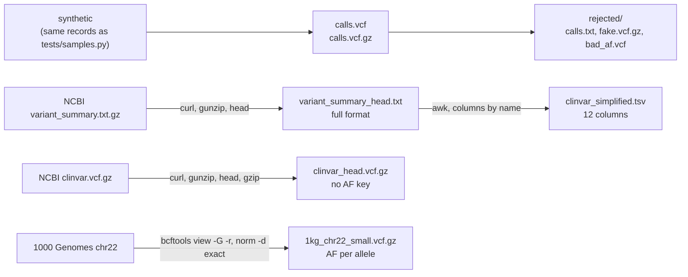

| Part of the script | What it does and why |
|---|---|
| `needed` | Skips a file that already exists, so a rerun does not download again; `FORCE=1` rebuilds |
| `head_of_remote_gz` | Streams a remote gzip and keeps the first N lines, without downloading the whole release (several GB unpacked). `head` closes the pipe early, so curl and gunzip die of SIGPIPE: pipefail is turned off for that pipeline and the line count is checked instead. A moved URL fails with a clear message |
| awk step | Picks the 12 simplified columns from the full file by header name, not position, because NCBI appends columns over time (step 5) |
| bcftools step | `-r` with the remote index downloads only the region; `-G` drops the 2,504 sample columns; `norm -d exact` removes exact duplicates, which the parser rejects (step 4). Skipped with a message when `bcftools` is not installed |
| `rejected/` | One file per 422 case: wrong extension, fake gzip, AF count mismatch |

What each file exercises:
- `variant_summary_head.txt` and `clinvar_simplified.tsv` give the same counts (about 19,700
  valid and 300 invalid rows in a 2026 release): the two formats of the same data.
- `clinvar_head.vcf.gz` has `AF_ESP`, `AF_EXAC`, `AF_TGP` in INFO but no `AF`, so every variant
  is stored with `af` null: the "missing AF" case.
- `1kg_chr22_small.vcf.gz` has multi-allelic sites with one AF per allele.

All of it is public, consented data. If NCBI or the 1000 Genomes FTP moves a file, browse its
parent folder and update the URL constants at the top of the script.

Start the full stack and try it with these files:

```bash
docker compose up --build -d --wait api
P=$(curl -s -X POST http://127.0.0.1:8000/api/v1/projects/ -H 'content-type: application/json' \
  -d '{"name": "BRCA cohort", "lead_scientist": "Rosalind Franklin"}' | python3 -c 'import json,sys; print(json.load(sys.stdin)["project_id"])')
curl -s -i -F file=@datasets/calls.vcf.gz http://127.0.0.1:8000/api/v1/projects/$P/vcf/   # 201 + Location
curl -s -F file=@datasets/clinvar_head.vcf.gz http://127.0.0.1:8000/api/v1/projects/$P/vcf/  # af null
curl -s "http://127.0.0.1:8000/api/v1/projects/$P/vcf/"
curl -s -F file=@datasets/variant_summary_head.txt http://127.0.0.1:8000/api/v1/projects/$P/annotation/
curl -s -F file=@datasets/rejected/bad_af.vcf http://127.0.0.1:8000/api/v1/projects/$P/vcf/   # 422
curl -s "http://127.0.0.1:9000/gva-files?list-type=2"     # the objects in local S3
curl -s -o /dev/null -w "%{http_code}\n" -X DELETE http://127.0.0.1:8000/api/v1/projects/$P/  # 204
docker compose down
```

To run the API with Poetry instead, start only the services it needs. `--env-file .env` loads the
whole `.env` into the process environment, which is where boto3 looks for credentials:

```bash
docker compose up -d db s3-init
poetry run alembic upgrade head
poetry run uvicorn app.main:create_app --factory --reload --env-file .env
```

## Step 12. Tests

| Folder | New this week | Storage |
|---|---|---|
| `tests/unit/` | parsers, services, in-memory repositories, S3 storage against moto, error mapping | in memory, moto in process |
| `tests/api/` | every endpoint and status code over HTTP | in-memory services |
| `tests/integration/` | SQL repositories (batched insert, jsonb, cascades), full upload lifecycle, after-commit contract | Postgres `test_db`, S3 in memory |

Test inputs are built in code (`tests/samples.py`: `vcf_text`, `sample_vcf`, `full_row`,
`clinvar_text`, `sample_clinvar`), never binary fixture files: each test shows the data it relies
on, and gzip input is made with `gzip.compress` (Repeatable, Self-validating).

Fixtures:

| File | Provides |
|---|---|
| `tests/conftest.py` | `settings`, in-memory `repository`, `storage`, `vcf_repository`, `annotation_repository`, the three services, and `project_id` (one project created through the in-memory repository) |
| `tests/api/conftest.py` | `client`: the real app with the three service dependencies overridden by the in-memory services |
| `tests/api/helpers.py` | `PROJECTS`, `create_project(client)`, `upload(client, url, filename, data)` asserting 201 |
| `tests/integration/conftest.py` | `e2e_client`: the real app on `test_db` with storage replaced by `InMemoryFileStorage` (since step 9, deleting a project touches S3, so the week 1 end-to-end test uses it too) |

What each test file covers (one behaviour per test):

| File | Behaviours |
|---|---|
| `tests/unit/test_text_parser.py` | extension match and case, filename length, plain and gzip decode, multi-member gzip, gzip bomb limit, NUL / bad UTF-8 / fake gzip rejected, byte order mark dropped |
| `tests/unit/test_vcf_parser.py` | multi-allelic split with AF per allele, `AF=.`, flags in INFO, sample count, each rejection rule with its line number, duplicates, symbolic and breakend ALT, NaN and inf |
| `tests/unit/test_clinvar_parser.py` | both formats detected, header with and without `#`, newer full header with extra columns, invalid rows counted, empty file and no valid entries rejected |
| `tests/unit/test_vcf_file_service.py`, `test_annotation_file_service.py` | stored metadata and file, server-built key, gzip, logs ids not filenames, unknown project, bad name and content with WARNING, delete, scoping to the project |
| `tests/unit/test_project_service.py` | `delete_project` removes the project prefix from storage |
| `tests/unit/test_in_memory_file_repositories.py` | ids and timestamps assigned, `get` scoped to the project, delete removes the file (and its variants) |
| `tests/unit/test_file_storage.py` | `S3FileStorage` against `mock_aws()`: put, delete, paginated prefix delete, partial failure raises; `DeleteAfterCommitStorage` defers deletes and logs an orphan |
| `tests/unit/test_errors.py` | every concrete `DomainError` has a status in `STATUS_BY_ERROR`; `FileStorageError` is not a client error |
| `tests/api/test_vcf_files.py`, `test_annotation_files.py` | every status code in the table of step 10, `Location` header, paging limits, 413 from the header and from the body |
| `tests/integration/test_file_repositories.py` | batched insert (`INSERT_BATCH_SIZE + 1` rows, so the partial last batch runs), jsonb round trip, a 10 kb REF allele, cascade project to files to variants |
| `tests/integration/test_files_e2e.py` | upload, list, get, delete over HTTP on real Postgres |
| `tests/integration/test_unit_of_work.py` | after-commit actions run after a commit and are dropped when the request raises |

- `mock_aws()` replaces the AWS endpoints inside the process, so `S3FileStorage` runs its real
  boto3 calls against a fake bucket: no network, no account, milliseconds. The fake credentials
  are set per test with `monkeypatch`, so a developer's real AWS credentials can never be picked
  up.
- The 413 tests build their own app with `max_upload_bytes=10` (`model_copy` leaves the shared
  session-scoped settings untouched), so they need an 11-byte body, not a 50 MB one.
- `test_deleting_project_cascades_to_files` calls `expunge_all()` to drop the objects cached in
  the session, so the following queries really read the database.

Run:

```bash
poetry run pytest -m "not integration"     # unit + API, no Docker needed
docker compose up -d test_db
poetry run python scripts/check.py         # everything, fails below 80% line coverage
```

Expected: 193 passed, total coverage around 99% (around 92% without the integration tests).

CI needs no change: the new dependencies come from `poetry.lock`, the S3 tests use moto in
process, and the integration tests replace S3 with the in-memory storage.

## Step 13. README.md

Update the scope line, the branch table, the run instructions (Compose now starts `s3` and
`s3-init`) and the API table (the seven new endpoints from step 10). Add a "Test data" section: how
to run `scripts/generate_test_datasets.sh` and a table of each file with its endpoint and expected
status.

## Final verification

```bash
poetry install
docker compose up -d db test_db
poetry run alembic upgrade head && poetry run alembic check
poetry run python scripts/check.py
docker compose up --build -d --wait api
# upload, list, get, delete as in step 11
docker compose down
git push                                                          # watch CI go green
```

## Common pitfalls

| Symptom | Cause | Fix |
|---|---|---|
| `RuntimeError: Form data requires "python-multipart" to be installed` | Dependency missing | `poetry add python-multipart` |
| 422 `field required` on upload | Field name is not `file`, or JSON was sent | `curl -F file=@calls.vcf ...` (multipart) |
| 500 with `NoCredentialsError` | API run with Poetry without AWS variables | `--env-file .env` (step 11) |
| 500 with `NoSuchBucket` | Local S3 restarted (in-memory) or `s3-init` did not run | `docker compose up -d s3-init` |
| 500 with `EndpointConnectionError` | `S3_ENDPOINT_URL` wrong or `s3` not running | `docker compose up -d s3-init`; locally use `http://localhost:9000`, in Compose `http://s3:5000` |
| Integration tests call real S3 | App built without the storage override | Use the `e2e_client` fixture |
| A domain error comes back as 500 | The new exception does not inherit from `NotFoundError`, `ConflictError` or `InvalidInputError` | Subclass the right base; `tests/unit/test_errors.py` catches it |
| `alembic check` reports changes after adding `ProjectFileMixin` | Column type, index or default differs from the original model | Keep the mixin columns exactly as the migration created them |
| mypy: `"VcfFileModel" has no attribute "file_id"` | Missing `synonym` on the model, or the mixin lacks the `TYPE_CHECKING` declaration | Add `file_id = synonym("<pk name>")` (step 6) |
| 422 `decompressed file is larger than ...` for a small `.gz` | The content after decompression is over `MAX_UPLOAD_BYTES` (the gzip bomb guard) | Raise `MAX_UPLOAD_BYTES` or split the file |
| 422 `AF has 1 values for 2 ALT alleles` | AF must have one value per ALT allele | Fix the file (`bcftools +fill-tags` recomputes AF) |
| ClinVar file rejected with a header error | Header renamed or fewer than 32 columns | Use the NCBI file or the exact 12-column header |
| Event loop stalls under load during uploads | Blocking boto3 call or parsing in `async def` | Wrap it in `asyncio.to_thread` (steps 7 and 9) |
| Editor warning `asynccontextmanager` is deprecated | Function annotated `-> AsyncIterator[...]`; the decorator needs `athrow` and `aclose`, which only an async generator has | Annotate `-> AsyncGenerator[...]` (`main.py`, `session.py`) |
| 500 `index row size exceeds btree maximum` | A unique index over `ref`/`alt` | Do not index unbounded allele text (step 6) |
| S3 objects still there after a delete, ERROR `Orphaned file after commit` | S3 refused the delete after the commit | Fix bucket permissions; delete the logged keys |
| `skip 1kg_chr22_small.vcf.gz (bcftools not installed ...)` | `bcftools` missing | `sudo apt install bcftools`, rerun the script |
| `error could not read <url>` from the dataset script | NCBI or 1000 Genomes moved the file, or no network | Browse the parent folder, update the URL constant |
| 422 duplicate variant for a bcftools slice | Duplicates left in by a hand-made slice | `bcftools norm -d exact` (the script does it) |
